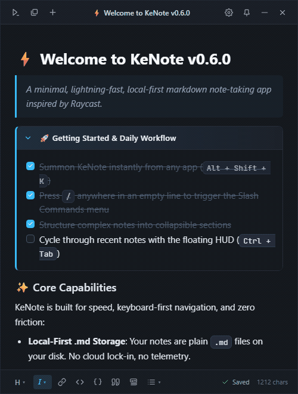
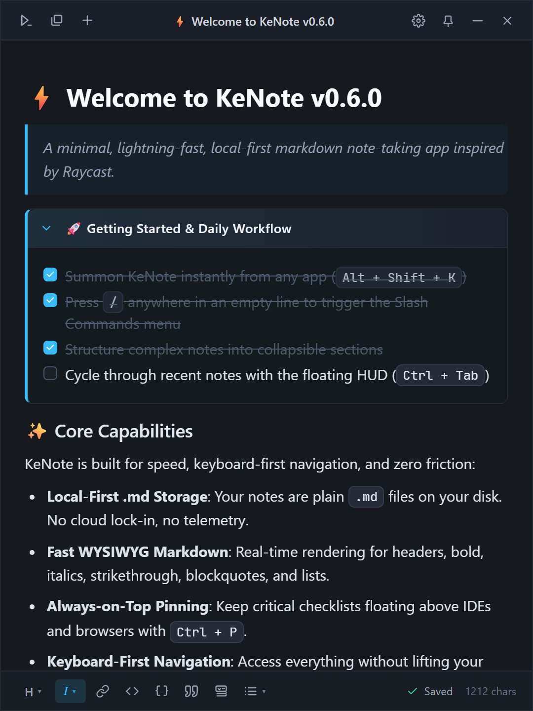
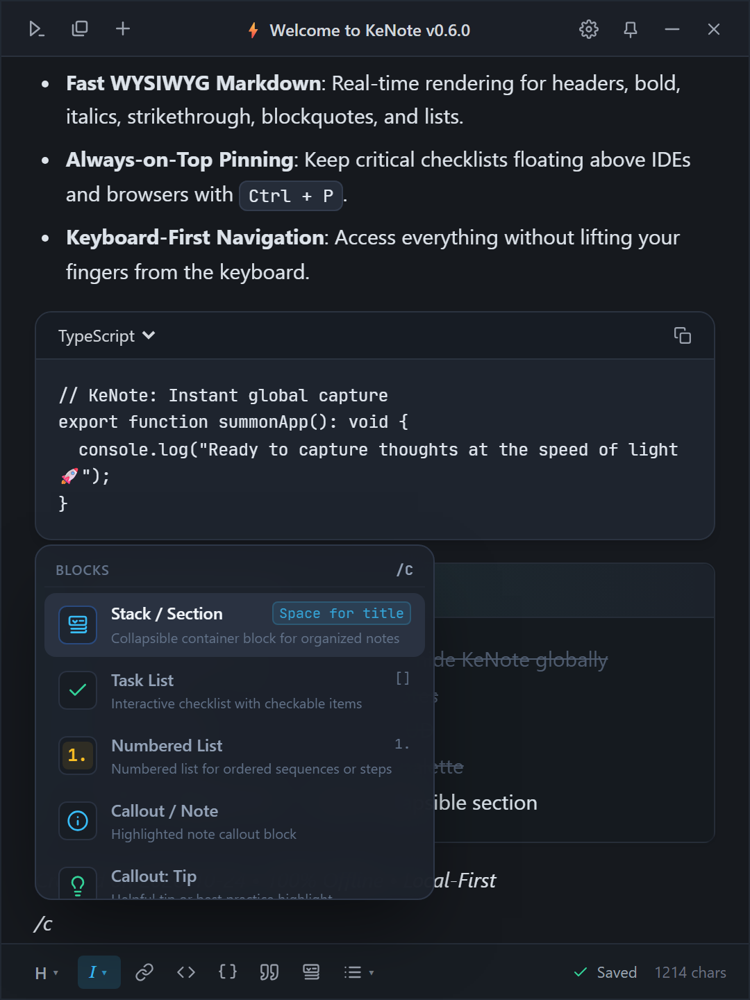
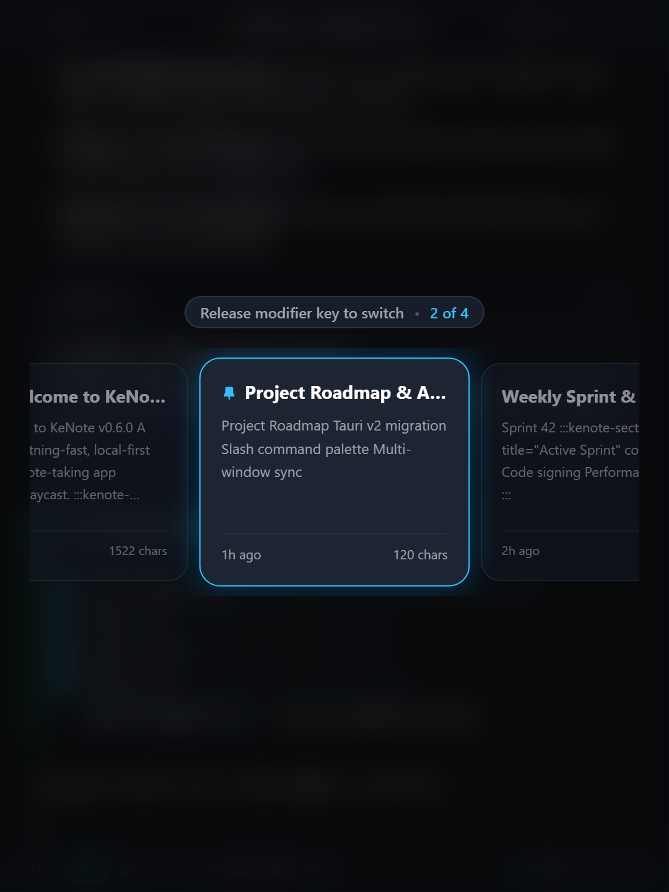
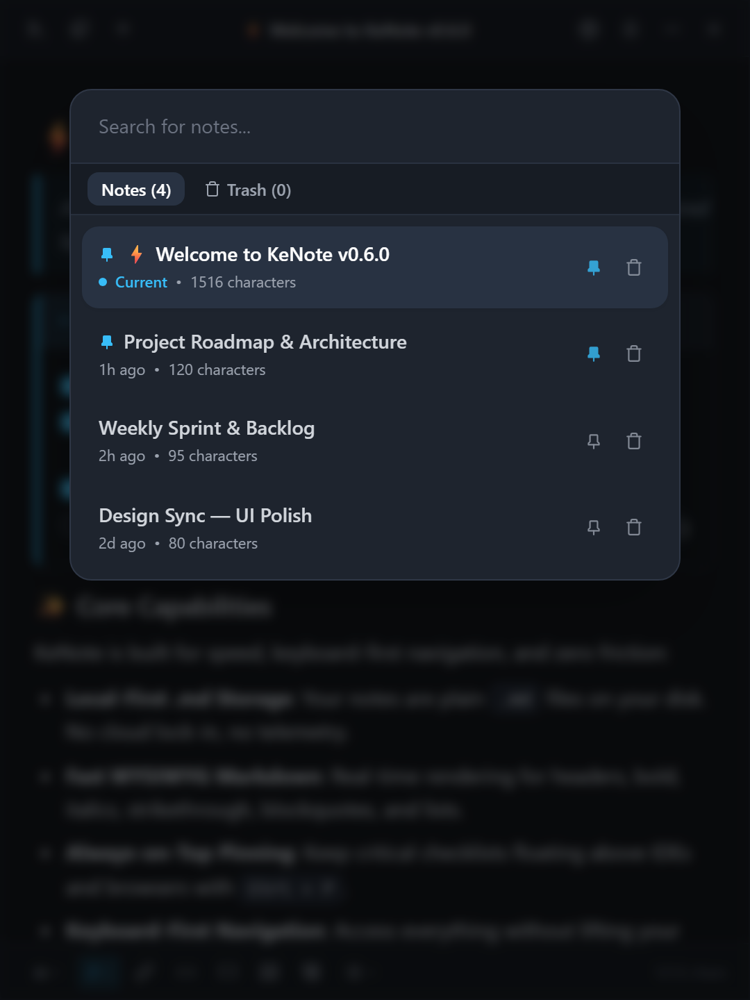
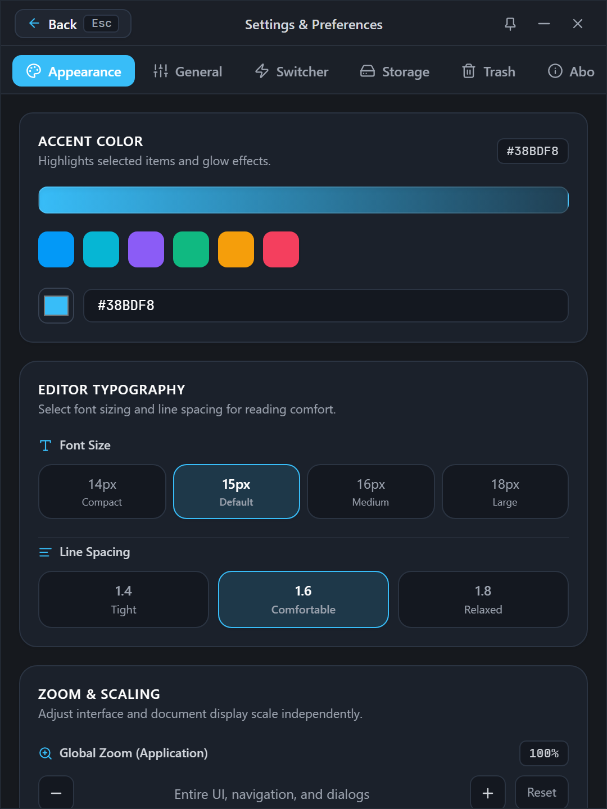

# KeNote ⚡

> A minimal, lightning-fast, local-first Raycast-inspired markdown note-taking app for Windows, macOS, and Linux built with **Tauri v2**, **React**, **TypeScript**, and **Tailwind CSS**.

<p align="center">
  <a href="https://github.com/yetemgetaB/Kenote/releases/latest"></a>
  
  
  
</p>

<p align="center">
  
</p>

---

## 📸 Interface Tour

<p align="center">
  
  
</p>
<p align="center">
  
  
</p>
<p align="center">
  
</p>

---

## ✨ Features

- ⚡ **Slash Command Menu (`/`)**: Press `/` in an empty line or block to instantly insert headings, task lists, code blocks, callouts, collapsible sections, dividers, and current timestamps.
- 📝 **Live WYSIWYG Markdown Formatting**: Headings (`#`), bold (`**`), italics (`*`), strikethrough (`~~`), underline, blockquotes (`>`), and task lists (`[ ]`) render seamlessly live as you type.
- 📂 **Collapsible Sections & Outlines**: Structure long notes into collapsible sections (`:::kenote-section` or `Ctrl + Shift + S`) with custom colors, task completion badges (`[2/4]`), and smooth fold/unfold toggles.
- 🔁 **Quick Switcher HUD (MRU)**: Cycle through recently visited notes with a Raycast-style floating HUD overlay using `Ctrl + Tab` or `Alt + Tab`.
- 🖱️ **Refined Native Context Menu**: Clean right-click menu with spelling suggestions, word actions (lookup, synonyms), text formatting, and quick clipboard actions.
- 🌐 **Global Launch Shortcut**: Summon or hide KeNote from anywhere across your OS with customizable global hotkeys (`Alt + Shift + K` by default) with an interactive keycap shortcut recorder.
- 🗂️ **Note Switcher & Fast Search**: Browse, filter, pin, and manage all your notes instantly with `Ctrl + O`.
- 📌 **Always-On-Top Pinning**: Keep your notes floating over active apps, code editors, and browsers with a single click or `Ctrl + P`.
- 💾 **100% Local-First Storage**: Your notes belong to you — stored directly as standard `.md` markdown files on your drive with automatic debounce saving, custom folder selection, and live disk sync.
- ⚡ **Command Actions Palette**: Quick-access all commands, actions, and settings with `Ctrl + K`.
- 🗑️ **Trash & Instant Undo**: Safely delete notes to trash with toast-based undo and recovery options.
- 🔍 **Independent Zoom Scaling**: Scale UI elements and editor text independently (`Ctrl + +`, `Ctrl + -`, `Ctrl + 0`).
- 🎨 **Custom Accent Themes & Typography**: Dynamic accent colors, gradient presets, customizable editor fonts, line heights, and sizes.
- 💻 **Syntax Highlighting & Copy Code**: Code blocks with automatic language detection, syntax highlighting, and 1-click clipboard copying.
- 🔄 **Built-in Auto-Updater**: Seamless background and on-demand update checks powered by Tauri's native updater.

---

## ⌨️ Keyboard Shortcuts

| Shortcut | Action |
| --- | --- |
| `Alt + Shift + K` | Global Summon / Hide KeNote (Customizable) |
| `/` | Open Slash Commands Menu (Headings, Checklists, Code, Callouts) |
| `Ctrl + N` | Create New Note |
| `Ctrl + O` | Browse Notes Switcher & Search |
| `Ctrl + K` | Open Actions / Command Palette |
| `Ctrl + Tab` / `Alt + Tab` | Quick Switcher HUD (Cycle Recent Notes) |
| `Ctrl + P` | Toggle Pin Always On Top |
| `Ctrl + S` | Force Save Note to Disk |
| `Ctrl + Shift + S` | Insert Collapsible Section |
| `Ctrl + ,` | Open Settings & Preferences |
| `Ctrl + Shift + C` | Copy Note as Markdown |
| `Ctrl + +` / `Ctrl + =` | Zoom In UI |
| `Ctrl + -` | Zoom Out UI |
| `Ctrl + 0` | Reset UI Zoom |
| `Esc` | Close Modal / Dismiss Menu / Cancel Quick Switcher |

---

## 📝 Demo Notes & Features Showcase

To explore all supported formatting in one place, check out the [Feature Showcase Note](docs/demo-notes/Kenote-Features-Showcase.md). You can copy its contents straight into KeNote to experience collapsible sections, syntax highlighting, and task tracking live.

---

## 🛠️ Tech Stack

- **Desktop Core**: [Tauri v2](https://tauri.app) (Rust)
- **Frontend**: [React 18](https://react.dev), [TypeScript](https://www.typescriptlang.org), [Vite](https://vitejs.dev)
- **Styling**: [Tailwind CSS](https://tailwindcss.com)
- **Rich Editor**: [Tiptap Editor](https://tiptap.dev) + [tiptap-markdown](https://github.com/hunghoang7300/tiptap-markdown)
- **Icons**: [Lucide Icons](https://lucide.dev)

---

## 🚀 Development & Build

### Prerequisites

- [Node.js](https://nodejs.org) (v18+) & [pnpm](https://pnpm.io)
- [Rust](https://rustup.rs)

### Install Dependencies

```bash
pnpm install
```

### Run in Development

```bash
pnpm tauri dev
```

### Run Tests

```bash
pnpm test
```

### Build Production Executable / Installer

```bash
pnpm tauri build
```

The output installers (`.exe`, `.dmg`, `.AppImage`) will be generated in `src-tauri/target/release/bundle/`.

---

## 📄 License

MIT License (c) 2026 [yetemgetaB](https://github.com/yetemgetaB)
